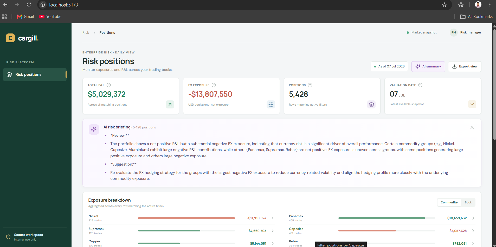

# Corporate Risk Reporting (CRR)

A full-stack risk-position reporting app built with .NET 10, React, TypeScript, AG Grid Community, PostgreSQL, and a separate Python AI summary API. The supplied CSV contains 50,000 positions.

> **Want to skip PostgreSQL setup?** Switch to the `csv_in_memory` branch with `git checkout csv_in_memory`. That branch loads the CSV into memory, so you can go straight to [Run all three applications](#run-all-three-applications).

## PostgreSQL setup

Complete these steps from the repository root before starting the API on the current branch.

1. Install PostgreSQL and make sure the server is running. Create a database named `crr` if it does not already exist; for example, run `createdb -U postgres crr` from a terminal with PostgreSQL's command-line tools installed.
2. Check `backend/Crr.Api/appsettings.json` and update `ConnectionStrings:RiskPositions` for your PostgreSQL host, database, username, and password. You can override this setting with .NET user-secrets or the `ConnectionStrings__RiskPositions` environment variable.
3. Install the EF Core command-line tool once:

   ```powershell
   dotnet tool install --global dotnet-ef --version 10.0.12
   ```

4. Apply the schema migration:

   ```powershell
   dotnet ef database update --project backend/Crr.Api/Crr.Api.csproj
   ```

5. Import the CSV:

   ```powershell
   dotnet run --project backend/Crr.Api -- --import-csv risk_positions.csv
   ```

The importer validates the header, fields, and values, rejects duplicate trade IDs, and loads rows with PostgreSQL `COPY` in a transaction. If the import fails, the transaction is rolled back. It rejects IDs that already exist in the database, so do not run it again after a successful import unless you have cleared the imported rows.

## Requirements

- .NET 10 SDK
- Node.js 20+ and npm
- Python 3.11+
- PostgreSQL for the current branch; PostgreSQL is not needed on `csv_in_memory`

## Run all three applications

Start each application in a separate terminal from the repository root. On the current branch, finish [PostgreSQL setup](#postgresql-setup) first.

### 1. .NET API

```powershell
dotnet run --project backend/Crr.Api
```

The API listens on `http://localhost:5080`. Check `http://localhost:5080/api/health`. Swagger UI is at `http://localhost:5080/swagger/index.html` and the OpenAPI document is at `http://localhost:5080/swagger/v1/swagger.json`.

### 2. React frontend

```powershell
cd frontend
npm install
npm run dev
```

Open `http://localhost:5173`. The Vite development server proxies `/api` requests to the .NET API on port 5080.

### 3. Python AI summary API

Set `GROQ_API_KEY` in `python-ai/.env` to enable AI-generated summaries, then start the service:
You can create `GROQ_API_KEY` from https://console.groq.com/keys its free

```powershell
cd python-ai
py -m venv .venv
.venv\Scripts\Activate.ps1
pip install -r requirements.txt
if (-not (Test-Path .env)) { Copy-Item .env.example .env }
```

```powershell
uvicorn main:app --reload --host 127.0.0.1 --port 8000
```

The Python health check is `http://localhost:8000/health`; its interactive docs are at `http://localhost:8000/docs`. The .NET API calls the Python endpoint; change `PythonAi:BaseUrl` (environment variable `PythonAi__BaseUrl`) if the service runs at another address. Without `GROQ_API_KEY`, the Python service still starts, but AI summary requests return 503.

If PowerShell blocks virtual-environment activation, use the environment's Python executable directly:

```powershell
.venv\Scripts\python.exe -m pip install -r requirements.txt
if (-not (Test-Path .env)) { Copy-Item .env.example .env }
.venv\Scripts\python.exe -m uvicorn main:app --reload --host 127.0.0.1 --port 8000
```

## Features

- AG Grid Community Infinite Row Model with 100-row server-backed blocks and bounded cache.
- Server-side sorting, text/numeric/date filters, and quick search across trade ID, counterparty, and commodity.
- P&L, FX, and group summaries calculated across all matching rows, not only the visible page.
- Commodity and book breakdowns; position totals are shown for commodity groups, not mixed-unit book groups.
- Trade detail drilldown and server-generated CSV export for the active filters.
- Optional AI narrative generated from aggregate data by the Python service; provider credentials stay in that service.

## API

- `GET /api/risk-positions?startRow=0&endRow=100&sortModel=[]&filterModel={}&q=` — paginated rows and filtered count.
- `GET /api/risk-positions/summary?groupBy=commodity&filterModel={}&q=` — filtered totals and grouped aggregates.
- `GET /api/risk-positions/export?sortModel=[]&filterModel={}&q=` — CSV download for all matching rows.
- `GET /api/risk-positions/summary/ai?groupBy=commodity&filterModel={}&q=` — AI narrative via the Python service.
- `GET /api/health` — API health check.

Filter and sort parameters use AG Grid's JSON model format. The API accepts only whitelisted fields and sort keys.

## Run Python tests

From `python-ai`, install the development requirements and run pytest:

```powershell
.venv\Scripts\python.exe -m pip install -r requirements-dev.txt
.venv\Scripts\python.exe -m pytest -q
```

## Project layout

- `backend/Crr.Api/Controllers` — HTTP routes and response handling.
- `backend/Crr.Api/Services` — database queries, filtering, summaries, export, and CSV import.
- `backend/Crr.Api/Data` — EF Core PostgreSQL context and migrations.
- `backend/Crr.Api/Models` — risk-position entity and API response models.
- `frontend` — React + TypeScript UI and AG Grid.
- `python-ai` — FastAPI service and LangChain agent for AI summaries.
- `risk_positions.csv` — supplied synthetic dataset of 50,000 rows.
- `DESIGN.md` — architecture decisions and tradeoffs.

## Product preview



[Watch the product recording](<./product recording.mp4>)
